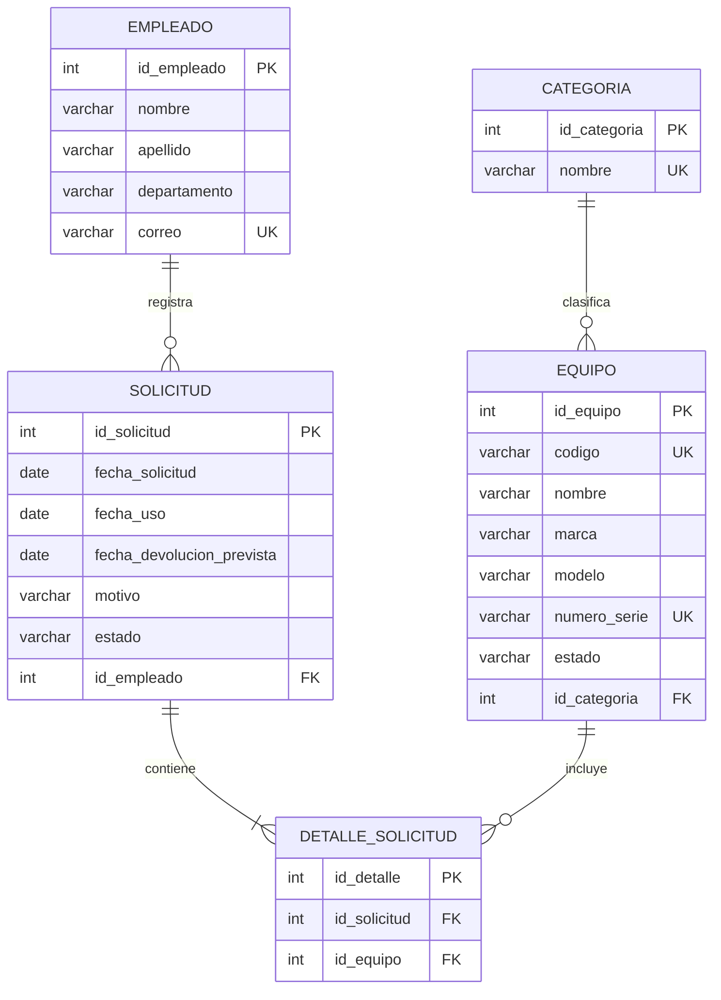

# 1. Introducción

El Sistema de Gestión de Préstamo de Equipo Audiovisual es una aplicación de escritorio desarrollada en Java, utilizando Swing para la interfaz gráfica, JDBC para la conexión con la base de datos y MySQL para el almacenamiento de la información.

El sistema permite administrar los empleados que solicitan equipos, las categorías utilizadas para clasificar el inventario, los equipos disponibles y las solicitudes de préstamo. También permite registrar los equipos asociados a cada solicitud y consultar la información almacenada.

Para garantizar la organización y consistencia de los datos, la base de datos se estructura mediante entidades relacionadas entre sí, claves primarias, claves foráneas y restricciones de integridad. Asimismo, se analiza la normalización hasta la tercera forma normal (3FN), con el propósito de reducir la redundancia y evitar anomalías durante las operaciones de inserción, actualización y eliminación.

# 2. Objetivos

## 2.1. Objetivo general

Documentar el diseño técnico y el modelo de datos del Sistema de Gestión de Préstamo de Equipo Audiovisual, describiendo sus entidades, atributos, relaciones, cardinalidades, normalización, modelo relacional y restricciones de integridad.

## 2.2. Objetivos específicos

- Representar gráficamente las entidades y relaciones de la base de datos mediante un diagrama entidad-relación.
- Identificar las entidades que participan en el proceso de préstamo de equipos.
- Describir los atributos de cada entidad, incluyendo sus claves primarias y foráneas.
- Establecer las relaciones y cardinalidades entre las entidades.
- Explicar el proceso de normalización hasta la tercera forma normal.
- Presentar el modelo relacional de la base de datos.
- Definir las restricciones de integridad necesarias para mantener la consistencia de la información.
- Facilitar el mantenimiento y las futuras mejoras de la aplicación.

---

# 3. Diagrama Entidad-Relación

El diagrama entidad-relación representa gráficamente la estructura de la base de datos y muestra cómo se relacionan los empleados, las categorías, los equipos, las solicitudes y los detalles de cada solicitud.

## 3.1. Diagrama ER



**Simbología utilizada:**

- `PK`: clave primaria (*Primary Key*).
- `FK`: clave foránea (*Foreign Key*).
- `UK`: atributo con restricción de unicidad (*Unique Key*).
- `||`: exactamente una entidad relacionada.
- `o{`: cero o muchas entidades relacionadas.
- `|{`: una o muchas entidades relacionadas.

**Nota técnica:** el diagrama representa el modelo lógico previsto. Los nombres de columnas, los tipos y las restricciones deben verificarse contra el script SQL real del proyecto. La cardinalidad mínima obligatoria entre una solicitud y sus detalles debe garantizarse mediante la lógica de la aplicación o una regla adicional, ya que una clave foránea por sí sola no obliga a que exista un detalle.

## 3.2. Explicación del diagrama

El modelo se compone de cinco entidades principales:

1. **EMPLEADO:** identifica a la persona que solicita los equipos.
2. **CATEGORIA:** permite clasificar los equipos según su tipo.
3. **EQUIPO:** almacena los datos del inventario audiovisual.
4. **SOLICITUD:** registra la petición de préstamo realizada por un empleado.
5. **DETALLE_SOLICITUD:** relaciona una solicitud con cada equipo que se incluye en ella.

La entidad `DETALLE_SOLICITUD` es necesaria porque una solicitud puede incluir varios equipos y un mismo equipo puede aparecer en diferentes solicitudes a lo largo del tiempo.

---

# 4. Identificación de entidades

Una entidad representa un objeto, persona, concepto o evento del cual se necesita almacenar información en una base de datos.

En este sistema se identifican las siguientes entidades.

## 4.1. Entidad EMPLEADO

Representa a las personas que pueden solicitar equipos audiovisuales.

**Propósito:** almacenar la información de identificación y contacto del empleado responsable de una solicitud.

**Ejemplo:** un empleado del departamento de informática que solicita un proyector para una presentación.

## 4.2. Entidad CATEGORIA

Representa los tipos o grupos en los que se clasifican los equipos.

**Propósito:** organizar el inventario y facilitar la identificación de equipos con características similares.

**Ejemplos:** proyectores, cámaras, micrófonos, computadoras y otros dispositivos audiovisuales.

## 4.3. Entidad EQUIPO

Representa cada equipo registrado en el inventario.

**Propósito:** almacenar los datos necesarios para identificar, clasificar y controlar el estado de cada equipo.

**Ejemplo:** un proyector identificado con el código `PRO-001`, de una marca y modelo determinados.

## 4.4. Entidad SOLICITUD

Representa la petición de préstamo realizada por un empleado.

**Propósito:** registrar las fechas, el motivo del préstamo y el estado en que se encuentra el proceso.

**Ejemplo:** una solicitud de un proyector para utilizarlo durante una exposición académica.

## 4.5. Entidad DETALLE_SOLICITUD

Representa cada equipo incluido en una solicitud.

**Propósito:** permitir que una solicitud incluya varios equipos sin almacenar múltiples identificadores de equipos en una misma columna.

**Ejemplo:** una solicitud que contiene un proyector, una computadora portátil y un micrófono tendrá tres registros en `DETALLE_SOLICITUD`.

---

# 5. Identificación de atributos

Los atributos son las propiedades que describen a cada entidad. Cada atributo almacena un dato específico.

Los siguientes tipos de datos son una propuesta técnica para el modelo. Deben ajustarse a los tipos y longitudes definidos en el esquema SQL real.

## 5.1. Atributos de EMPLEADO

| Atributo | Tipo sugerido | Descripción | Restricción |
|---|---|---|---|
| `id_empleado` | INT | Identificador del empleado | PK, autoincremental |
| `nombre` | VARCHAR(100) | Nombre del empleado | NOT NULL |
| `apellido` | VARCHAR(100) | Apellido del empleado | NOT NULL |
| `departamento` | VARCHAR(100) | Departamento al que pertenece | Según requisitos |
| `correo` | VARCHAR(150) | Correo electrónico | UNIQUE, si se exige |

La clave primaria `id_empleado` permite identificar de forma única a cada empleado, incluso cuando existan personas con nombres iguales.

## 5.2. Atributos de CATEGORIA

| Atributo | Tipo sugerido | Descripción | Restricción |
|---|---|---|---|
| `id_categoria` | INT | Identificador de la categoría | PK, autoincremental |
| `nombre` | VARCHAR(100) | Nombre de la categoría | NOT NULL, UNIQUE |

La restricción de unicidad en `nombre` evita que se creen categorías duplicadas cuando se requiere que cada categoría tenga un nombre exclusivo.

## 5.3. Atributos de EQUIPO

| Atributo | Tipo sugerido | Descripción | Restricción |
|---|---|---|---|
| `id_equipo` | INT | Identificador del equipo | PK, autoincremental |
| `codigo` | VARCHAR(30) | Código interno del equipo | NOT NULL, UNIQUE |
| `nombre` | VARCHAR(120) | Nombre del equipo | NOT NULL |
| `marca` | VARCHAR(80) | Marca del equipo | Según requisitos |
| `modelo` | VARCHAR(80) | Modelo del equipo | Según requisitos |
| `numero_serie` | VARCHAR(100) | Número de serie del fabricante | UNIQUE, si existe |
| `estado` | VARCHAR(30) | Estado actual del equipo | Valor controlado |
| `id_categoria` | INT | Categoría a la que pertenece | FK |

El atributo `id_categoria` permite conocer la categoría del equipo sin repetir su nombre en todos los registros del inventario.

## 5.4. Atributos de SOLICITUD

| Atributo | Tipo sugerido | Descripción | Restricción |
|---|---|---|---|
| `id_solicitud` | INT | Identificador de la solicitud | PK, autoincremental |
| `fecha_solicitud` | DATE | Fecha de registro de la solicitud | NOT NULL |
| `fecha_uso` | DATE | Fecha prevista de utilización | NOT NULL |
| `fecha_devolucion_prevista` | DATE | Fecha prevista para devolver el equipo | NOT NULL |
| `motivo` | VARCHAR(255) | Razón de la solicitud | Según requisitos |
| `estado` | VARCHAR(30) | Estado del proceso de préstamo | Valor controlado |
| `id_empleado` | INT | Empleado que realiza la solicitud | FK |

La clave foránea `id_empleado` establece quién es responsable de la solicitud.

## 5.5. Atributos de DETALLE_SOLICITUD

| Atributo | Tipo sugerido | Descripción | Restricción |
|---|---|---|---|
| `id_detalle` | INT | Identificador del detalle | PK, autoincremental |
| `id_solicitud` | INT | Solicitud a la que pertenece | FK |
| `id_equipo` | INT | Equipo incluido en la solicitud | FK |

Se recomienda agregar una restricción `UNIQUE (id_solicitud, id_equipo)` si un mismo equipo no debe aparecer repetido dentro de una solicitud.

---

# 6. Relaciones entre entidades

Una relación representa la asociación entre dos entidades dentro del modelo de datos.

## 6.1. Relación EMPLEADO — SOLICITUD

Un empleado registra solicitudes de préstamo.

- Un empleado puede registrar varias solicitudes.
- Cada solicitud está asociada a un empleado responsable.
- La relación se implementa mediante `SOLICITUD.id_empleado`, que referencia `EMPLEADO.id_empleado`.

**Tipo de relación:** uno a muchos (1:N).

## 6.2. Relación CATEGORIA — EQUIPO

Una categoría agrupa equipos que pertenecen a un mismo tipo.

- Una categoría puede estar asociada a varios equipos.
- Cada equipo pertenece a una categoría, de acuerdo con el modelo propuesto.
- La relación se implementa mediante `EQUIPO.id_categoria`.

**Tipo de relación:** uno a muchos (1:N).

## 6.3. Relación SOLICITUD — DETALLE_SOLICITUD

Una solicitud puede contener varios equipos, representados individualmente en la tabla de detalles.

- Una solicitud puede tener uno o varios detalles.
- Cada detalle pertenece a una solicitud.
- La relación se implementa mediante `DETALLE_SOLICITUD.id_solicitud`.

**Tipo de relación:** uno a muchos (1:N).

## 6.4. Relación EQUIPO — DETALLE_SOLICITUD

Cada detalle identifica el equipo que forma parte de una solicitud.

- Un equipo puede aparecer en distintos detalles de diferentes solicitudes a lo largo del tiempo.
- Cada detalle referencia un equipo.
- La relación se implementa mediante `DETALLE_SOLICITUD.id_equipo`.

**Tipo de relación:** uno a muchos (1:N).

## 6.5. Relación conceptual SOLICITUD — EQUIPO

Desde el punto de vista del negocio, una solicitud puede incluir varios equipos y un equipo puede participar en varias solicitudes históricas.

Por ello, la relación conceptual es de muchos a muchos (N:M), resuelta mediante la entidad asociativa `DETALLE_SOLICITUD`.

---

# 7. Cardinalidades

La cardinalidad indica cuántas ocurrencias de una entidad pueden relacionarse con una ocurrencia de otra entidad.

| Relación | Cardinalidad | Cardinalidad mínima y máxima |
|---|---|---|
| EMPLEADO — SOLICITUD | 1:N | Un empleado puede tener 0..N solicitudes; cada solicitud tiene 1 empleado |
| CATEGORIA — EQUIPO | 1:N | Una categoría puede clasificar 0..N equipos; cada equipo tiene 1 categoría |
| SOLICITUD — DETALLE_SOLICITUD | 1:N | Una solicitud tiene 1..N detalles, según la regla del negocio; cada detalle pertenece a 1 solicitud |
| EQUIPO — DETALLE_SOLICITUD | 1:N | Un equipo puede aparecer en 0..N detalles históricos; cada detalle referencia 1 equipo |
| SOLICITUD — EQUIPO | N:M | Una solicitud puede incluir varios equipos y un equipo puede figurar en varias solicitudes históricas |

## 7.1. Interpretación

### EMPLEADO — SOLICITUD

La participación del empleado en las solicitudes es opcional, porque un empleado puede estar registrado sin haber realizado todavía ningún préstamo. Sin embargo, cada solicitud debe identificar al empleado responsable.

### CATEGORIA — EQUIPO

Una categoría puede existir antes de que se registren equipos asociados. En el modelo propuesto, cada equipo debe tener una categoría válida.

### SOLICITUD — DETALLE_SOLICITUD

La regla de negocio indica que una solicitud válida debería contener al menos un equipo. No obstante, una clave foránea solamente garantiza que cada detalle apunte a una solicitud existente; no garantiza por sí sola que toda solicitud tenga un detalle. Esta regla debe controlarse mediante la aplicación o una estrategia adicional en la base de datos.

### EQUIPO — DETALLE_SOLICITUD

Un equipo puede no haber sido prestado todavía. Si se conserva el historial de solicitudes, el mismo equipo podrá aparecer en múltiples registros de detalle a lo largo del tiempo.

**Regla importante:** que un equipo aparezca en diferentes solicitudes históricas no significa que pueda prestarse simultáneamente. La disponibilidad debe controlarse mediante reglas de negocio y operaciones transaccionales.

---

# 8. Proceso de normalización hasta 3FN

La normalización es el proceso de organizar las tablas de una base de datos para reducir la duplicación de información y prevenir anomalías durante la inserción, modificación o eliminación de datos.

Para este proyecto se consideran la primera forma normal (1FN), la segunda forma normal (2FN) y la tercera forma normal (3FN).

## 8.1. Situación inicial: tabla no normalizada

Imaginemos que toda la información se almacenara en una sola tabla:

`REGISTRO_PRESTAMO`

| id_solicitud | empleado | correo | equipos | categorias | fecha_uso |
|---|---|---|---|---|---|
| 1 | Ana López | ana@ejemplo.com | Proyector, Micrófono | Proyección, Audio | 2026-10-15 |
| 2 | Carlos Pérez | carlos@ejemplo.com | Cámara | Fotografía | 2026-10-16 |

Esta estructura presenta varios problemas:

- El campo `equipos` contiene varios valores.
- El campo `categorias` también puede contener varios valores.
- Es difícil identificar cada equipo individualmente.
- Los datos del empleado podrían repetirse en muchas filas.
- Una actualización podría modificar unos datos y dejar otros inconsistentes.

Por estas razones, se requiere normalizar la información.

## 8.2. Primera forma normal (1FN)

Una tabla cumple la primera forma normal cuando cada campo contiene un solo valor y no existen grupos repetitivos dentro de una misma fila.

### Aplicación al proyecto

En lugar de almacenar una lista de equipos dentro de una columna, se registra cada equipo por separado mediante `DETALLE_SOLICITUD`.

Por ejemplo, una solicitud con dos equipos genera dos filas:

| id_solicitud | id_equipo |
|---|---|
| 1 | 10 |
| 1 | 15 |

Cada celda contiene un valor individual y las filas pueden identificarse de manera independiente.

### Resultado de 1FN

Se separan los datos en entidades como:

- `EMPLEADO`
- `CATEGORIA`
- `EQUIPO`
- `SOLICITUD`
- `DETALLE_SOLICITUD`

Esto elimina los grupos de valores múltiples dentro de una columna.

## 8.3. Segunda forma normal (2FN)

Una tabla cumple la segunda forma normal cuando cumple 1FN y todos sus atributos no clave dependen de la clave primaria completa, no solo de una parte de ella.

Esta regla es especialmente importante en tablas cuya clave primaria está formada por varias columnas.

### Aplicación al proyecto

En `DETALLE_SOLICITUD`, los datos propios de la relación son las referencias a la solicitud y al equipo. La descripción del empleado no debe almacenarse allí, porque depende del empleado relacionado con la solicitud y no de la asociación completa entre solicitud y equipo.

De igual forma:

- El nombre del equipo pertenece a `EQUIPO`.
- El nombre de la categoría pertenece a `CATEGORIA`.
- Los datos del empleado pertenecen a `EMPLEADO`.
- Las fechas y el motivo pertenecen a `SOLICITUD`.

Aunque `DETALLE_SOLICITUD` utilice una clave sustituta `id_detalle`, es recomendable definir `UNIQUE(id_solicitud, id_equipo)` si el negocio no permite duplicar un equipo dentro de la misma solicitud.

### Resultado de 2FN

Los datos descriptivos se almacenan en las tablas a las que corresponden y se referencian mediante claves foráneas, evitando dependencias parciales.

## 8.4. Tercera forma normal (3FN)

Una tabla cumple la tercera forma normal cuando cumple 2FN y los atributos no clave no dependen transitivamente de la clave primaria.

En términos sencillos, los atributos descriptivos deben depender de la clave de su propia tabla, no de otro atributo no clave.

### Aplicación al proyecto

- Los datos personales dependen de `id_empleado`.
- El nombre de una categoría depende de `id_categoria`.
- Los datos de inventario dependen de `id_equipo`.
- Las fechas y el motivo dependen de `id_solicitud`.
- Las referencias que relacionan equipos y solicitudes se almacenan en `DETALLE_SOLICITUD`.

Por ejemplo, el nombre de una categoría no se repite en la tabla `EQUIPO`. En su lugar, `EQUIPO` almacena `id_categoria`, y el nombre se obtiene mediante una relación entre tablas.

### Resultado de 3FN

La información queda distribuida de acuerdo con su entidad, se reduce la redundancia y se simplifica el mantenimiento de los datos.

## 8.5. Resumen de la normalización

| Forma normal | Requisito | Aplicación |
|---|---|---|
| 1FN | Valores atómicos y sin grupos repetitivos | Cada equipo de una solicitud se registra en un detalle independiente |
| 2FN | Sin dependencias parciales de una clave compuesta | Los atributos descriptivos permanecen en sus entidades correspondientes |
| 3FN | Sin dependencias transitivas de atributos no clave | Los datos de empleados, categorías y equipos se almacenan por separado |

**Conclusión de la normalización:** el modelo propuesto se organiza para cumplir los principios de 1FN, 2FN y 3FN, siempre que las dependencias funcionales reales de las tablas coincidan con las descritas y que el esquema SQL implemente las claves y restricciones correspondientes.

---

# 9. Modelo relacional

El modelo relacional representa las entidades como tablas y define sus atributos, claves primarias y relaciones mediante claves foráneas.

## 9.1. Relación EMPLEADO

```text
EMPLEADO(
    id_empleado PK,
    nombre,
    apellido,
    departamento,
    correo UK
)
```

- **Clave primaria:** `id_empleado`.
- **Clave única sugerida:** `correo`.
- **Función:** almacenar los datos de las personas que solicitan equipos.

## 9.2. Relación CATEGORIA

```text
CATEGORIA(
    id_categoria PK,
    nombre UK
)
```

- **Clave primaria:** `id_categoria`.
- **Clave única sugerida:** `nombre`.
- **Función:** clasificar los equipos por tipo.

## 9.3. Relación EQUIPO

```text
EQUIPO(
    id_equipo PK,
    codigo UK,
    nombre,
    marca,
    modelo,
    numero_serie UK,
    estado,
    id_categoria FK -> CATEGORIA.id_categoria
)
```

- **Clave primaria:** `id_equipo`.
- **Claves únicas sugeridas:** `codigo` y `numero_serie`.
- **Clave foránea:** `id_categoria`.
- **Función:** mantener el inventario y el estado de los equipos.

Si algunos equipos no tienen número de serie, debe definirse una política adecuada para ese campo y su unicidad.

## 9.4. Relación SOLICITUD

```text
SOLICITUD(
    id_solicitud PK,
    fecha_solicitud,
    fecha_uso,
    fecha_devolucion_prevista,
    motivo,
    estado,
    id_empleado FK -> EMPLEADO.id_empleado
)
```

- **Clave primaria:** `id_solicitud`.
- **Clave foránea:** `id_empleado`.
- **Función:** almacenar los datos generales de cada solicitud de préstamo.

## 9.5. Relación DETALLE_SOLICITUD

```text
DETALLE_SOLICITUD(
    id_detalle PK,
    id_solicitud FK -> SOLICITUD.id_solicitud,
    id_equipo FK -> EQUIPO.id_equipo,
    UNIQUE(id_solicitud, id_equipo)
)
```

- **Clave primaria:** `id_detalle`.
- **Claves foráneas:** `id_solicitud` e `id_equipo`.
- **Restricción única sugerida:** la combinación `id_solicitud` e `id_equipo`.
- **Función:** identificar los equipos incluidos en cada solicitud.

## 9.6. Resumen del modelo relacional

| Tabla | Clave primaria | Claves foráneas |
|---|---|---|
| EMPLEADO | `id_empleado` | Ninguna |
| CATEGORIA | `id_categoria` | Ninguna |
| EQUIPO | `id_equipo` | `id_categoria` |
| SOLICITUD | `id_solicitud` | `id_empleado` |
| DETALLE_SOLICITUD | `id_detalle` | `id_solicitud`, `id_equipo` |

Las claves únicas adicionales propuestas no sustituyen las claves primarias. Su finalidad es impedir duplicados en atributos que deben identificar valores exclusivos según las reglas del sistema.

---

# 10. Restricciones de integridad

Las restricciones de integridad son reglas que aseguran que los datos almacenados sean válidos, consistentes y estén relacionados correctamente.

## 10.1. Integridad de entidad

Garantiza que cada fila pueda identificarse de manera única.

**Reglas:**

- Cada tabla debe disponer de una clave primaria.
- Una clave primaria no puede contener valores nulos.
- Los valores de una clave primaria no pueden repetirse.

**Aplicación:**

- `EMPLEADO.id_empleado`
- `CATEGORIA.id_categoria`
- `EQUIPO.id_equipo`
- `SOLICITUD.id_solicitud`
- `DETALLE_SOLICITUD.id_detalle`

## 10.2. Integridad referencial

Garantiza que las relaciones entre las tablas no apunten a registros inexistentes.

**Reglas:**

- `EQUIPO.id_categoria` debe referenciar una categoría existente.
- `SOLICITUD.id_empleado` debe referenciar un empleado existente.
- `DETALLE_SOLICITUD.id_solicitud` debe referenciar una solicitud existente.
- `DETALLE_SOLICITUD.id_equipo` debe referenciar un equipo existente.

Las reglas `ON DELETE` y `ON UPDATE` deben elegirse de acuerdo con las necesidades del proyecto. Para conservar el historial de préstamos, puede ser preferible restringir la eliminación de registros que tengan detalles o solicitudes asociados.

## 10.3. Integridad de dominio

Controla los valores permitidos para cada atributo.

**Reglas recomendadas:**

- El nombre y apellido del empleado deben contener valores válidos.
- El código y nombre del equipo no deben quedar vacíos.
- Las fechas deben ser válidas.
- La fecha prevista de devolución no debe ser anterior a la fecha de uso.
- Los estados del equipo deben pertenecer a un conjunto definido, por ejemplo, `Disponible`, `Prestado` o `Mantenimiento`.
- Los estados de la solicitud deben corresponder a las opciones admitidas por la aplicación.
- El correo electrónico debe cumplir un formato válido.
- Los códigos internos de los equipos no deben repetirse.

La lista exacta de estados debe coincidir con los valores implementados en el código Java y en la base de datos.

## 10.4. Integridad de unicidad

Evita que se registren valores duplicados en atributos que deben ser únicos.

**Restricciones sugeridas:**

- `UNIQUE(EMPLEADO.correo)`, si cada empleado debe tener un correo exclusivo.
- `UNIQUE(CATEGORIA.nombre)`, si no se permiten categorías con el mismo nombre.
- `UNIQUE(EQUIPO.codigo)`.
- `UNIQUE(EQUIPO.numero_serie)`, si los números de serie se registran y deben ser exclusivos.
- `UNIQUE(DETALLE_SOLICITUD.id_solicitud, DETALLE_SOLICITUD.id_equipo)`, si un equipo solo puede aparecer una vez por solicitud.

## 10.5. Integridad de negocio

Establece reglas propias del proceso de préstamo.

### Disponibilidad del equipo

Un equipo no debe asignarse a dos solicitudes que impliquen períodos de préstamo incompatibles. La comprobación debe realizarse de forma segura al guardar la solicitud, preferentemente dentro de una transacción, para evitar conflictos si dos usuarios intentan reservar el mismo equipo simultáneamente.

### Actualización del estado

Cuando un equipo se entrega, su estado debe reflejar que está prestado. Cuando se devuelve, debe actualizarse según las reglas del sistema y su condición física.

### Eliminación de solicitudes

Una solicitud que tenga información histórica importante no debería eliminarse sin considerar los detalles relacionados. Puede ser preferible cambiar su estado a cancelada para conservar la trazabilidad.

### Consistencia de fechas

Se recomienda validar que:

- La fecha de uso no sea anterior a la fecha de solicitud, salvo que el negocio permita registrar solicitudes retroactivas.
- La fecha prevista de devolución sea igual o posterior a la fecha de uso.
- Las fechas de devolución efectiva, si se incorporan posteriormente, sean coherentes con las fechas del préstamo.

## 10.6. Diferencia entre validaciones y restricciones

Las validaciones de Java mejoran la experiencia del usuario y permiten mostrar mensajes claros. Sin embargo, una validación ejecutada únicamente en la interfaz puede evitarse si los datos se modifican por otra vía.

Por ello, las reglas fundamentales deben respaldarse con restricciones SQL cuando sea posible, además de validaciones en la aplicación.

---

# 11. Recomendaciones para la implementación

1. Verificar que las cinco tablas existan en la base de datos `prestamo_audiovisual`.
2. Comprobar que los tipos de datos y nombres de las columnas coincidan con los utilizados en las clases Java.
3. Revisar las claves primarias y foráneas.
4. Aplicar las restricciones `UNIQUE`, `NOT NULL` y `CHECK` que correspondan a las reglas reales del proyecto.
5. Utilizar `PreparedStatement` para ejecutar consultas parametrizadas.
6. Cerrar las conexiones, sentencias y resultados JDBC de forma adecuada.
7. Usar transacciones cuando una operación modifique varias tablas.
8. Probar el proceso completo: registro de empleado, creación de categoría, registro de equipo, creación de solicitud y devolución.
9. Verificar que no sea posible asignar un equipo a préstamos simultáneos incompatibles.
10. Realizar respaldos de la base de datos antes de realizar cambios estructurales.

---

# 12. Conclusiones

El Sistema de Gestión de Préstamo de Equipo Audiovisual requiere una estructura de datos organizada que permita registrar empleados, clasificar equipos, administrar solicitudes y conservar el detalle de cada préstamo.

La elaboración del diagrama entidad-relación permite visualizar las entidades y sus asociaciones. La identificación de atributos facilita definir la información necesaria para cada tabla, mientras que las relaciones y cardinalidades establecen cómo se conectan los registros.

La normalización hasta la tercera forma normal ayuda a disminuir la redundancia y a mantener los datos descriptivos en las entidades correspondientes. El modelo relacional convierte el diseño conceptual en tablas relacionadas mediante claves primarias y foráneas.

Finalmente, las restricciones de integridad y las reglas de negocio son esenciales para mantener la consistencia de los registros y evitar errores en la asignación, entrega y devolución de los equipos.

# 13. Bibliografía

- Oracle. (s. f.). *Java Documentation*. https://docs.oracle.com/en/java/
- Oracle. (s. f.). *JDBC Database Access*. https://docs.oracle.com/javase/tutorial/jdbc/
- Oracle. (s. f.). *Java Swing*. https://docs.oracle.com/javase/tutorial/uiswing/
- MySQL. (s. f.). *MySQL Reference Manual*. https://dev.mysql.com/doc/
- Elmasri, R. y Navathe, S. *Fundamentals of Database Systems*. Pearson.
